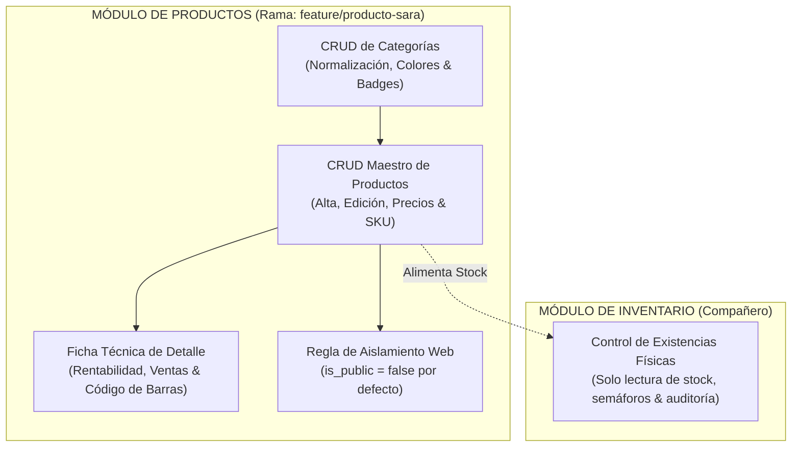
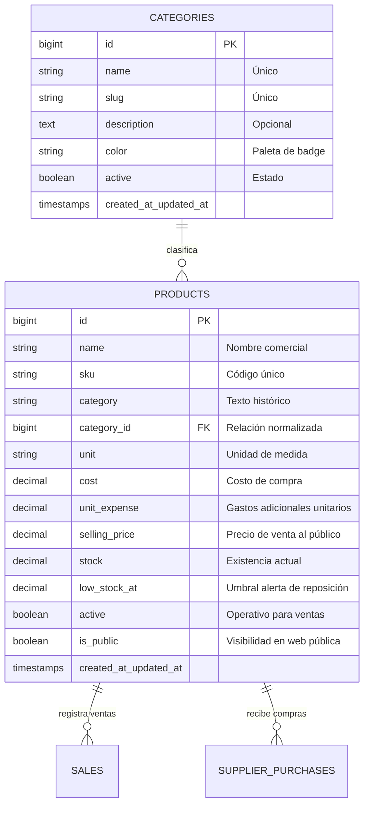

# Documentación Técnica y Funcional: Módulo de Productos
**Proyecto**: NEXO Bodega  
**Rama de Desarrollo**: `feature/producto-sara`  
**Responsable del Módulo**: Sara  
**Framework**: Laravel 13 (PHP 8.4) + Vite + Tailwind CSS v4 + SQLite  

---

## 1. Resumen Ejecutivo y Alcance

Este documento describe en detalle el desarrollo, arquitectura y puesta en marcha del **Módulo de Productos** para el sistema de gestión comercial **NEXO Bodega**.

El proyecto global está distribuido entre diferentes integrantes del equipo (Ventas, Clientes, Proveedores, Inventario y Productos). La responsabilidad directa de este módulo abarca:

1. **Gestión Maestra del Catálogo de Productos**: Alta, edición, ficha técnica detallada, cálculo automático de márgenes/precios y baja controlada.
2. **CRUD de Categorías Normalizado**: Clasificación jerárquica con paletas visuales de color, slugs automáticos y protección de integridad referencial.
3. **Aislamiento Estricto de la Página Pública**: Regla de negocio que garantiza que ningún producto nuevo ingresado en el panel administrativo aparezca en la tienda web pública a menos que se autorice explícitamente.
4. **Desacoplamiento Funcional frente al Módulo de Inventario**: Clara separación entre la administración del catálogo comercial (Productos) y la consulta de existencias físicas para almacén (Inventario).



---

## 2. Entorno y Estrategia de Aislamiento Local

Para evitar dañar otros proyectos existentes en el equipo (bases de datos MySQL compartidas en el puerto 3306 o servidores Apache/Nginx en el puerto 80), se implementó un aislamiento estricto:

* **Base de Datos**: Se utiliza exclusivamente **SQLite** (`database/database.sqlite`), confinando todos los datos dentro de la carpeta del proyecto sin alterar motores externos.
* **Paquetes y Librerías**: Instalación local confinada en `./vendor` y `./node_modules`. Cero modificaciones a paquetes globales.
* **Servidor Local Dedicado**: Ejecución en puerto independiente `http://127.0.0.1:8000` sin tocar archivos de configuración del sistema (`hosts`, vhosts de Laragon).

---

## 3. Modelo de Datos y Migraciones

### 3.1. Estructura de Entidades



### 3.2. Migraciones Creadas
* `database/migrations/2026_11_17_150000_create_categories_table.php`: Crea la tabla normalizada `categories`.
* `database/migrations/2026_11_17_150001_add_category_id_to_products_table.php`: Incorpora la llave foránea `category_id` manteniendo sincronía con el campo histórico de texto `category`.
* `database/migrations/2026_11_17_153000_add_is_public_to_products_table.php`: Añade la bandera booleana `is_public` (default `false`) para controlar la visibilidad pública.

> [!IMPORTANT]
> **Compatibilidad Bidireccional**: Para no romper el código de otros compañeros ni las vistas existentes, cuando se guarda o actualiza un producto, el sistema sincroniza automáticamente tanto el `category_id` relacional como el string `category` plano.

---

## 4. Desarrollo de CRUDs y Componentes

### 4.1. CRUD de Categorías (`/admin/categorias`)
* **Controlador**: `app/Http/Controllers/CategoryController.php`
* **Funcionalidades**:
  * **Listado (`index`)**: Muestra categorías con buscador por término, filtro por estado (activas/inactivas) y un contador dinámico de productos asociados que enlaza directamente al catálogo filtrado.
  * **Creación y Edición (`create` / `edit`)**: Generación automática de slug y selector visual de color (`fuchsia`, `violet`, `emerald`, `amber`, `sky`, `rose`).
  * **Eliminación Segura (`destroy`)**: Implementa una regla de protección que bloquea el borrado si la categoría contiene productos asociados, indicando la cantidad exacta que debe ser reasignada.
* **Vistas Blade**:
  * `resources/views/admin/categories/index.blade.php`
  * `resources/views/admin/categories/form.blade.php`

---

### 4.2. CRUD Maestro de Productos (`/admin/productos`)
* **Controlador**: `app/Http/Controllers/ProductController.php`
* **Funcionalidades**:
  * **Catálogo Principal (`index`)**:
    * 4 Tarjetas métricas superiores: Total activos, Alertas de reposición, Agotados y Valuación del inventario al costo.
    * Buscador en tiempo real por Nombre, SKU o Categoría.
    * Filtro por categoría y por estado de existencias (Óptimo, Stock bajo, Agotado).
    * Indicadores visuales de visibilidad: distintivo `Admin` (privado) vs `Público`.
  * **Registro y Modificación (`create` / `edit`)**:
    * **Generador de Código SKU**: Función en JavaScript integrada para autogenerar prefijo y correlativo en un clic.
    * **Calculadora de Rentabilidad en Vivo**: Simula en tiempo real el precio sugerido, la ganancia unitaria y la barra de margen según la fórmula comercial:
      $$\text{Precio Sugerido} = \frac{\text{Costo} + \text{Gasto Unitario}}{1 - \frac{\text{Margen}}{100}}$$
    * **Selector de Visibilidad**: Checkbox desmarcado por defecto para asegurar que el producto no se muestre en la web pública.
  * **Ficha Técnica Detallada (`show`)**:
    * Métricas de rendimiento: Unidades vendidas históricas, ingresos acumulados y utilidad bruta generada.
    * Visualización simulada de código de barras escaneable para puntos de venta.
    * Historial de últimas ventas registradas para el producto.
  * **Baja de Productos (`destroy`)**:
    * Validación de integridad referencial: Si el producto cuenta con ventas o compras asociadas, se bloquea el borrado permanente y se sugiere desactivarlo para preservar la contabilidad histórica.
* **Vistas Blade**:
  * `resources/views/admin/products/index.blade.php`
  * `resources/views/admin/products/form.blade.php`
  * `resources/views/admin/products/show.blade.php`

---

### 4.3. Módulo Separado de Inventario (`/admin/inventario`)
* **Controlador**: `app/Http/Controllers/InventoryController.php`
* **Objetivo**: Proporcionar un espacio aislado para el compañero de equipo encargado del almacén.
* **Características**:
  * Vista de solo lectura enfocada en el monitoreo físico de stock.
  * Semáforo de existencias: Verde (Óptimo), Ámbar (Reponer pronto), Rojo (Agotado).
  * Exporte de datos a formato CSV compatible con Microsoft Excel.
  * **Sin opciones de edición de precios ni borrado de productos**, delimitando claramente la autoría de cada integrante.
* **Vista Blade**:
  * `resources/views/admin/inventory/index.blade.php`

---

## 5. Menú de Navegación del Panel (`layouts/admin.blade.php`)

La barra lateral fue actualizada para reflejar la separación clara de responsabilidades:

```text
OPERACIONES
├── 🏠 Inicio (Dashboard)
├── 👥 Clientes
├── 🛍️ Productos     <-- Módulo de Sara (Catálogo Maestro y CRUD Completo)
├── 🏷️ Categorías    <-- Clasificación de Productos
├── 📦 Inventario    <-- Módulo de Almacén (Solo existencias físicas)
├── 🚚 Proveedores
└── 📈 Ventas y finanzas
```

---

## 6. Pruebas Automatizadas y Aseguramiento de Calidad

Se implementó una batería de tests automatizados con PHPUnit para garantizar la estabilidad del módulo:

```powershell
php artisan test
```

### Resultados de la Suite (24 Pruebas - 105 Aserciones):

| Archivo de Prueba | Escenarios Verificados | Estado |
| :--- | :--- | :---: |
| `tests/Feature/ProductCrudTest.php` | Aislamiento en web pública (`assertDontSee`), Ficha técnica `show`, Filtros por estado de stock. | **PASS** |
| `tests/Feature/CategoryCrudTest.php` | Autenticación, Listado, Creación, Edición, Protección contra borrado de categorías con productos, Eliminación permitida de categorías vacías. | **PASS** |
| `tests/Feature/InventoryTest.php` | Acceso protegido, Visualización correcta de existencias en almacén. | **PASS** |
| `tests/Feature/BodegaFlowsTest.php` | Flujos transversales de venta, descuentos atómicos de stock, exportaciones Excel y renderizado integral. | **PASS** |
| `tests/Feature/ExampleTest.php` | Respuestas HTTP y verificación de inicio. | **PASS** |

> [!TIP]
> **Total**: **24 tests ejecutados con éxito, 0 fallos y 105 aserciones superadas**.

---

## 7. Mapa de Rutas del Módulo

| Método HTTP | Ruta URI | Nombre de Ruta | Controlador y Acción |
| :--- | :--- | :--- | :--- |
| `GET` | `/admin/productos` | `admin.products.index` | `ProductController@index` |
| `GET` | `/admin/productos/create` | `admin.products.create` | `ProductController@create` |
| `POST` | `/admin/productos` | `admin.products.store` | `ProductController@store` |
| `GET` | `/admin/productos/{product}` | `admin.products.show` | `ProductController@show` |
| `GET` | `/admin/productos/{product}/edit` | `admin.products.edit` | `ProductController@edit` |
| `PUT/PATCH` | `/admin/productos/{product}` | `admin.products.update` | `ProductController@update` |
| `DELETE` | `/admin/productos/{product}` | `admin.products.destroy` | `ProductController@destroy` |
| `GET` | `/admin/categorias` | `admin.categories.index` | `CategoryController@index` |
| `GET` | `/admin/categorias/create` | `admin.categories.create` | `CategoryController@create` |
| `POST` | `/admin/categorias` | `admin.categories.store` | `CategoryController@store` |
| `GET` | `/admin/categorias/{category}/edit`| `admin.categories.edit` | `CategoryController@edit` |
| `PUT/PATCH` | `/admin/categorias/{category}` | `admin.categories.update` | `CategoryController@update` |
| `DELETE` | `/admin/categorias/{category}` | `admin.categories.destroy` | `CategoryController@destroy` |
| `GET` | `/admin/inventario` | `admin.inventory.index` | `InventoryController@index` |
